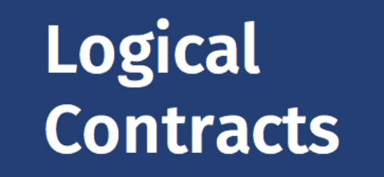

<!-- _class: title -->
<!-- _paginate: false -->
<!-- _footer: '' -->



# Sixteen rule languages, one readable language
## A tour, writing rules from ordinary language, and hands-on

Miguel Calejo · Logical Contracts
JURIX 2026 tutorial · Toulouse · 8 December 2026

<!--
45 minutes in three parts. The clock, from the start of this slide:
- 0:00 The tour of sixteen languages (15 minutes, with a live demonstration).
- 0:15 Writing rules from ordinary language (10 minutes, live).
- 0:25 Hands-on (20 minutes). Robert and I walk around the room.
Ask the room to open the lab page now: the QR code is on the next slide, and the page loads while the tour runs.
-->

---

# Open this now, for later

<div class="cols wide-left">
<div>

The lab page has the three exercises, the links, and the answers.

- A laptop with a web browser is enough
- Nothing to install
- No laptop? Work with your neighbour

<span class="small">The page: <code>LAB_URL</code></span>

</div>
<div class="center">


<div class="qr-caption">the lab page</div>

</div>
</div>

<!--
LAB_URL: replace with the address where lab/index.html is published (see README.md, "Before the day"), and make the QR code again with ./build.sh --qr.
-->

---

<!-- _class: divider -->

# 1 · A tour of sixteen rule languages, in five families

For each language: a real program, its Logical English twin, and how we checked the twin

<!--
Time: 0:01. This part ends at 0:15.
The pace is fast on purpose. The slides stay online; nobody must read every line now.
-->

---

# How to read the tour

<div class="big">

A **twin** is the translation of a program of another system into Logical English (LE), or into LE for LPS when the program changes a state over time.

</div>

- A **translator** writes each twin. The translators are programs, not a language model: the same input gives the same twin
- What the translator cannot translate stays in the twin as a **TODO** comment, with the source text
- The twin carries **scenarios** with the answers that the **source system's own engine** gave. A scenario is a set of facts, and its expected answers make it a test
- **File ▸ Show the Original…** shows the source beside the twin

<!--
The key word is "checked". We do not claim that a twin is right because it reads well. We claim that it gives the same answers as the source system, on the cases we could run, and we say how many.
A twin and its ledger: the ledger lists what was translated, what was not, and why.
-->

---

# Five families, sixteen languages

<div class="dense">

| Family | Languages | Twin in | Checked against |
|---|---|---|---|
| **Legal and academic formalisms** | LegalRuleML · s(CASP) and Prolog · Blawx · Epilog · L4 | LE (L4 contracts and Epilog games: LPS) | SPINdle · s(CASP) · Blawx · EpilogJS · L4's evaluator |
| **Rules as Code** for statutes, taxes, benefits | Axiom RuleSpec · PolicyEngine and OpenFisca · Catala | LE | each project's own engine or interpreter |
| **Decision management** | Drools rules (and DMN decision tables) · Oracle Intelligent Advisor | LPS, LE | a Drools session · the projects' test cases |
| **Industry configurations, financial regulation** | Socotra · Oracle Insurance Policy Administration · Rune (Digital Regulatory Reporting) | LE | reference runs · the reports that DRR expects |
| **Ledgers and contracts** | Solidity · Daml · Bitcoin Miniscript | LPS, LE | the Ethereum machine · a Canton ledger · a Bitcoin test chain |

</div>

<!--
Sixteen, counting PolicyEngine and OpenFisca as one, and s(CASP) and Prolog as one. Plus DMN, which came with Drools.
Public twins (the source licence allows it): LegalRuleML, s(CASP), Blawx, Epilog, L4, RuleSpec, Catala, Drools, DMN, OIPA, Solidity, Daml, Miniscript. Private (the licence of the source does not allow publication): OpenFisca and PolicyEngine country models, Oracle Intelligent Advisor, Socotra, Rune/DRR. I show the private ones on slides only.
-->

---

# Legal and academic formalisms <span class="fam">1 of 5</span>

<div class="cols twin">
<div>

### LegalRuleML (OASIS standard), section 29 of an Australian credit act

```xml
<lrml:PrescriptiveStatement key="ps1">
 <ruleml:Rule key=":rule1" closure="universal">
  <ruleml:if> … <ruleml:Rel iri=":person"/> …
  <ruleml:then> … <lrml:Prohibition> …
     <ruleml:Rel iri=":engageCreditActivity"/> …
```

### The twin, in Logical English

```
rule ps1:
a party is forbidden that the party engages in a credit activity if
    the party is a person
    and it is not the case that the party holds a credit licence.
```

</div>
<div class="mid">

| Language | Checked |
|---|---|
| LegalRuleML | SPINdle, 68 of 68 |
| s(CASP), Prolog | s(CASP), 23 of 23; round trip gives the same program for 87 of 93 |
| Blawx | Blawx, 163 of 163 in 15 projects |
| Epilog | EpilogJS, 21 of 21; games 71 of 75 |
| L4 | L4's evaluator, 621 of 621 rules |

</div>
</div>

<!--
LegalRuleML: deontic (obligations, permissions, prohibitions) and defeasible rules. The deontic library of LE (deontic.le) gives "violated", "in breach" and reparations. This twin is the one of the hands-on.
s(CASP): constructive negation and abduction. Blawx: a visual Rules as Code tool on top of s(CASP). Epilog: Stanford CodeX's logic programs; the games become LPS. L4: rules into LE, contracts into LPS.
Numbers: docs/user/integrations/gallery.md and lpsPlus docs/migration/roadmap.md. TO CONFIRM before the day: s(CASP) 21/21 + 2 pending (gallery) or 23/23 (roadmap).
-->

---

# Rules as Code for statutes, taxes and benefits <span class="fam">2 of 5</span>

<div class="cols twin">
<div>

### Axiom RuleSpec, the US food stamps (SNAP) maximum allotment

```yaml
formula: |-
  snap_maximum_allotment_table[max(min(household_size, 8), 1)]
  + (max(household_size - 8, 0) * snap_maximum_allotment_additional_member)
```

### The twin

```
the snap maximum allotment of a household is an amount N if
    … and the minimum of M and 8 is a number K
    and the maximum of K and 1 is a number P
    and the snap maximum allotment table for P is an amount Q …
    and N = Q + T * R.
```

</div>
<div class="mid">

| Language | Checked |
|---|---|
| Axiom RuleSpec | Axiom's engine, 473 of 473; written back, 37 of 39 pass, 2 refused |
| PolicyEngine, OpenFisca | the packages' own engines; French income tax 2,286 of 2,302 |
| Catala | Catala's interpreter, 129 of 129; written back, 42 of 42 |

<span class="small">Catala twins also exist in **Français Logique**, the French variant of LE.</span>

</div>
</div>

<!--
These languages compute amounts: taxes and benefits. The twin keeps the arithmetic, and each step of the arithmetic is a sentence that an explanation can show.
"Written back": LE to RuleSpec and LE to Catala exist. A twin that cannot be written back faithfully is refused, not approximated.
TO CONFIRM: the OpenFisca/PolicyEngine total (gallery says 719/774 in 6 models; the October runs say 598/598).
-->

---

# Decision management and business rules <span class="fam">3 of 5</span>

<div class="cols twin">
<div>

### Drools, a rule of its insurance example

```java
rule "young drivers are high risk"
  when Driver( $name : name, age == "young" )
       not Policy( driver == $name )
  then insert(new Policy($name, "high"));
```

### The twin, in Logical English for LPS

```
if there is a driver called a name with age young and record a record
    and it is not the case that
        there is a policy for the name with band a band
then a policy starts for the name with band high.
```

</div>
<div class="mid">

- Drools changes a **working memory**. The twin changes **the world**: `insert` is an event, with a causal law
- When the rules only insert facts, the translator also writes a **decision** with no time
- **DMN** decision tables stay tables in LE, with their hit policy

| Language | Checked |
|---|---|
| Drools | a Drools session, same final memory 5 of 5 |
| DMN | the test suite of DMN, 138 of 138; the way back, 424 of 424 |
| Oracle Intelligent Advisor | the projects' tests, 953 of 953 in 15 projects |

</div>
</div>

<!--
This is where LPS (Robert's part) is necessary: a production rule system is reactive, so its twin is reactive rules in LPS.
DMN: TCK 138/138, BDT 195/195, RONL 346/346, all against Drools as the DMN engine. LE → DMN 1.6: 424/424 TCK cases on Drools.
OIA twins are private (Oracle's licence). TO CONFIRM: 953/953 in 15 projects (roadmap, 15 Oct) against 475/476 in 5 (gallery).
-->

---

# Industry configurations and financial regulation <span class="fam">4 of 5</span>

<div class="cols twin">
<div>

### Oracle Insurance Policy Administration, a "math variable"

```xml
<MathVariable VARIABLENAME="InGraceMV" TYPE="IIF"
  EXPRESSION="DaysPastDueMV > 0 And DaysPastDueMV <= GracePeriodDaysMV">
  YesMV,NoMV
```

### The twin

```
rule in_grace with provenance "GraceCheck/Transaction.xml"
                         at MathVariable InGraceMV:
the in grace of an activity is a value if
    the days past due of the activity is a number N
    and the grace period days of the plan is a number M
    and N > 0 and N <= M and the value is equal to "Yes"
    otherwise … the value is equal to "No".
```

</div>
<div class="mid">

| Language | Checked |
|---|---|
| Socotra | a reference run of its scripts, 992 of 992 |
| OIPA | an independent interpreter of its maths, 103 of 103 |
| Rune (DRR) | the reports DRR expects: 99.1% of 102,879 fields; written back, 2,197 of 2,249 reports identical |

<span class="small">Rune is the language of the derivatives industry's **Digital Regulatory Reporting**: what a bank must report to a regulator, for each trade.</span>

</div>
</div>

<!--
"Rules" in industry are often configuration: XML, YAML, templates. The twin gives each rule a sentence and a provenance: the file and the element it came from.
Socotra and Rune twins are private (licences). OIPA twins are public.
Rune: the twin reads the same trade reports, and writes the same fields; the way back writes Rune that DRR's own engine runs.
-->

---

# Ledgers and contracts <span class="fam">5 of 5</span>

<div class="cols twin">
<div>

### Bitcoin Miniscript, an inheritance wallet (Liana)

```
or(99@pk(manager),
   or(9@and(thresh(2,pk(spouse),pk(first_child),pk(second_child)),
            older(52560)),
      and(pk(third_party),older(65535))))
```

### The twin

```
the coin can be spent if
    a number N is the count of each K such that
        a key K is in [the spouse, the elder child, the younger child]
        and the witness contains a signature by K
    and N >= 2
    and the coin has been confirmed for a number M blocks
    and M >= 52560.
```

</div>
<div class="mid">

| Language | Twin | Checked |
|---|---|---|
| Solidity | LPS | the Ethereum machine, a USD Coin history 849 of 849 |
| Daml | LPS | a Canton ledger; written back, 26 the same, 17 refused, 0 different |
| Miniscript | LE | a Bitcoin test chain, 361 of 361 |

- **Refusal is a feature**: when the way back cannot keep the meaning, the exporter says no

</div>
</div>

<!--
52560 blocks is about one year. The family shows the two kinds of rules of Robert's part: Miniscript is a condition (a belief rule, LE); Solidity and Daml are state and transitions (LPS, with constraints such as "it must not be true that a party other than the owner pauses the token").
LPS2 can also deploy an LPS program as Solidity.
-->

---

<!-- _class: demo -->

# Demo · A twin, live

1. **LE2**: open `migration/legalruleml/ex5_section29new/ex5_section29new`
2. **File ▸ Show the Original…** — the LegalRuleML beside the twin
3. Scenario `unlicensed_trader`, query `obligations`: Alice's two penalties, and **why**
4. Scenario `licensed_trader`, query `prohibitions`: no answer, and **why not**
5. **LPS2**: open `migration/drools/fire_alarm/fire_alarm.le`, **Run**, the **timeline**

<span class="small">Script: demos/tour_demo.md · backup: the screenshots in demos/</span>

<!--
Time: 0:11. Four minutes, no more. This demo is also exercise 1 and 2 of the hands-on: the room sees it once before they do it.
-->

---

# What the tour shows

<div class="big">

- The **same few ideas** come back in every family: conditions, exceptions, amounts, tables, obligations, events
- One readable language can carry all of them, **with the source beside it**
- A twin is **checked** against the source system's engine. A difference is a finding, about the twin or about the source
- Some twins go **both ways**: RuleSpec, Catala, DMN, Rune, Daml, Miniscript, and Solidity from LPS

</div>

<!--
Time: 0:14. One sentence on limits (Robert or the final part takes them up): what is Java in Drools, Python in OpenFisca, or Liquid in Socotra, and is not a rule, stays as TODO.
-->

---

<!-- _class: divider -->

# 2 · Writing rules from ordinary language

A language model proposes, the engine checks, the scenarios decide

<!--
Time: 0:15. This part ends at 0:25.
-->

---

# Three steps, and who is responsible for each

<div class="cols">
<div class="box soft compact">

### 1 · The model proposes
A large language model reads the text and writes Logical English: templates, rules, a scenario.

### 2 · The engine checks
The LE **verifier** reads the draft and reports each problem, for example a sentence that matches no template. The model must correct each problem.

### 3 · The scenarios decide
You write the cases, with the answers that the text gives. The program must give those answers.

</div>
<div>

- The model **never gives the answer**. The program gives it, each time the same
- A good scenario comes from **the text and from a person**, not from the model that wrote the rules
- Each answer has an **explanation**: the rules and facts that make it true

> A language model is good at language. A logic program is a good place to keep rules.

</div>
</div>

<!--
The verifier is deterministic: it parses and checks. The model loops until the verifier is quiet, then the scenarios run.
If the scenarios fail, the person decides: was the draft wrong, or was my reading of the text wrong? That decision is the work of a legal knowledge engineer.
-->

---

# Where the model works, in the editor

| Tool | Where | What it writes |
|---|---|---|
| **LE Assistant** | the bottom panel of the LE2 editor | it reads, writes, checks and runs the program that is open |
| **Write it in English** | the Scenario Editor and the Query Editor | facts or a question, with the templates of the program |
| **Contract Assistant** | a separate page | a whole program from a contract or a regulation: several drafts, the scenarios choose |

<span class="small">Set the model and its key: **Misc ▸ API Keys & Assistant Settings…** The model can be from OpenAI, Anthropic, Google and others.</span>

<!--
The Contract Assistant needs a licence on the public server. The LE Assistant works with the server's own keys, with a limit, or with your own key.
-->

---

<!-- _class: demo -->

# Demo · From a regulation to a tested program

**EU Regulation 261/2004, Article 7(1)**: compensation for a cancelled flight

1. Paste the article into the **LE Assistant**: *write the rules, and one scenario for each band*
2. Read the draft; the verifier's messages; the model's corrections
3. **Misc ▸ Run the Program's Tests…** — then change 1 500 km to 1 501 km in a scenario
4. The same article **in French**, into **Français Logique**

<span class="small">Script and texts: demos/writing_demo.md · compare with the example `regulatory/eu261_integration`</span>

<!--
Time: 0:18. Six minutes. If the network or the model is slow: open the result saved in demos/ (see the script) and show steps 2 to 4 on it.
-->

---

# The keywords are translated, not only the words

<div class="cols twin">
<div>

```
a person acquires British citizenship on a date
if the person is born in the UK on the date
    and the date is after commencement …
```

```
une personne acquiert la citoyenneté britannique à une date
si la personne naît au Royaume-Uni à la date
    et la date est postérieure à l'entrée en vigueur …
```

```
uma pessoa adquire cidadania britânica em uma data
se a pessoa nasceu em o Reino Unido em a data …
```

</div>
<div>

```
una persona adquiere ciudadanía británica en una fecha
si la persona nació en el Reino Unido en la fecha …
```

```
una persona acquisisce la cittadinanza britannica in una data
se la persona nasce in il Regno Unito in la data …
```

- English, French, Portuguese, Spanish, Italian: one engine, five grammars
- A program says its language in its first sentence: `la langue cible est : prolog.`
- Answers and explanations come in the language of the program

</div>
</div>

<!--
Examples: moreExamples/citizenship, fr/citoyennete, pt/cidadania, es/ciudadania, it/cittadinanza. The guide: docs/user/guide/languages.md.
The keywords, the system's templates, the messages and the editor's menus are all in CSV dictionaries; a new language is a new column.
Time: 0:24.
-->

---

<!-- _class: divider -->

# 3 · Hands-on

Twenty minutes. We walk around the room: raise a hand

<!--
Time: 0:25. Ends at 0:45. Robert and Miguel walk around. Keep the next slide on the screen during the whole exercise.
-->

---

# The three exercises

<div class="cols wide-left">
<div>

1. **A LegalRuleML twin** · 6 minutes
   Open it, read the original, ask *why* and *why not*
2. **A Drools twin** · 6 minutes
   Run the fire alarm, read the timeline, ask which rule made the alarm go on
3. **Break a rule** · 8 minutes
   Remove one condition from section 29, run the tests, and explain which scenarios fail

**More, if you finish:** open your own LegalRuleML or Drools file · write a rule in French · ask the LE Assistant

</div>
<div class="center">


<div class="qr-caption">the lab page: steps, links, answers</div>


<div class="qr-caption">le2.logicalcontracts.com</div>

</div>
</div>

<!--
Common problems to watch for while walking:
- The query box is empty: choose the query from the list beside Query, not type it.
- "No answers": that is the point of why not; click "Why not".
- In LPS2, the timeline is below the program; scroll.
- Exercise 3: the student deletes the line "and it is not the case that the party holds a credit licence" from rule ps1 (and puts the full stop after "a person"). Misc ▸ Run the Program's Tests… then shows 5 failures, all in scenario licensed_trader: Bob is forbidden, owes the penalties, and is in breach. The other 3 scenarios still pass. Good question for the student: Bob is now both permitted (ps2) and forbidden (ps1) — which rule should win? That is what LegalRuleML's defeasibility (overriding) is for. (Checked on 10 November 2026 with runTestsFor.)
- "bob is in breach" appears several times in the failure list: one per violated norm.
Opening one's own file (File ▸ Open… a .lrml or .drl) needs the workshop account: see README.md, "Before the day".
-->

---

# What to take home

<div class="cols wide-left">
<div>

- **Sixteen languages, five families**, one readable language between them
- Each twin is **checked** against the source system, and keeps the source beside it
- A language model **drafts**; the engine and **your scenarios** decide
- All of it runs in a browser, **open source** under the Apache 2.0 licence

<span class="small">le2.logicalcontracts.com · lps2.logicalcontracts.com · github.com/LogicalContractsOrg</span>

</div>
<div class="center">


<div class="qr-caption">the source code</div>

</div>
</div>

<!--
Time: 0:45. Hand over to the limitations and the discussion.
-->
