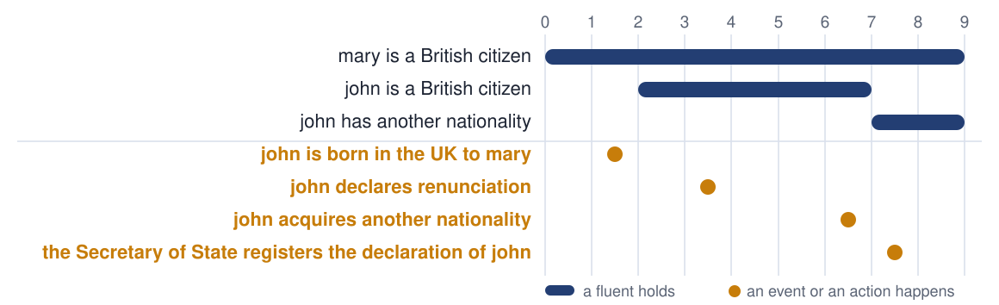

<!-- _class: title -->
<!-- _paginate: false -->
<!-- _footer: '' -->

# Two kinds of rules, in plain English

## Rule languages · Logical English · Logic Production Systems

Robert Kowalski · Imperial College London
JURIX 2026 tutorial · Toulouse · 8 December 2026

<!--
30 minutes, three parts. The clock, from the start of this slide:
- 0:00 The Act, and two kinds of rules (8 minutes).
- 0:08 Controlled natural language and Logical English (12 minutes).
- 0:20 Logic Production Systems (8 minutes).
- 0:28 What to take away, and hand over to Miguel.
One example carries the whole talk: two sections of the British Nationality Act 1981.
-->

---

# An Act of Parliament

> **British Nationality Act 1981, section 1**
>
> (1) A person born in the United Kingdom after commencement shall be a British citizen if at the time of the birth his father or mother is—
>
> (a) a British citizen; or
>
> (b) settled in the United Kingdom.

In 1986 we wrote this Act as a logic program, in Prolog. Forty years later the program is English again.

<!--
Sergot, Sadri, Kowalski, Kriwaczek, Hammond and Cory, The British Nationality Act as a Logic Program, Communications of the ACM, May 1986.
The text is the Act as enacted. Later amendments changed the wording.
The sentence already has the form of a rule: a conclusion, the word "if", and conditions. Parliament wrote a logic program without knowing it.
-->

---

<!-- _class: divider -->

# 1 · Rule languages

Two kinds of rules

<!--
Time: 0:01.
-->

---

# The Act has two kinds of sentence

<div class="cols">
<div>

### What is the case

> **1(1)** A person born in the United Kingdom … shall be a British citizen if …

It describes the world.

It is true or it is false.

It is a **belief**.

</div>
<div>

### What to do

> **12(1)** If any British citizen … makes … a declaration of renunciation …, the Secretary of State shall cause the declaration to be registered.

It does not describe the world.

It asks for the world to be changed.

It is a **goal**.

</div>
</div>

<!--
This is the one distinction of the first part. Every rule language makes it, or hides it.
Both sentences say "shall". The first "shall" defines who is a citizen. The second "shall" gives the Secretary of State something to do.
-->

---

# Belief rules

<div class="big">

*conclusion* **if** *conditions*

</div>

```
a person is a British citizen
    if the person is born in the UK
    and a parent of the person is a British citizen.
```

- A belief rule defines its conclusion in terms of its conditions
- A set of belief rules is a **logic program**
- The same rule is used **backwards**, to answer a question, and **forwards**, to derive a consequence

<!--
A simplified rule, to show the form. The full rule comes in part 2.
Backwards: is John a British citizen? He is, if he was born in the UK and a parent of his is a British citizen. Two smaller questions.
Forwards: John is born in the UK, and his mother is a citizen. So John is a citizen.
Prolog reasons backwards. Datalog reasons forwards. The rule is the same.
-->

---

# Goal rules

<div class="big">

**if** *conditions* **then** *conclusion*

</div>

```
if a British citizen declares renunciation
then the Secretary of State registers the declaration.
```

```
it must not be true that
    the Secretary of State registers the declaration of a person
    and it is not the case that the person has another nationality.
```

- A goal rule does not define anything. It must be **made true**, by acting
- The first kind is a **reactive rule**. The second kind is a **constraint**
- An obligation is a goal. A prohibition is a constraint

<!--
A belief can be false. A goal cannot be false: it can only be violated.
Production rules, event-condition-action rules and the obligations of deontic logic are all goal rules.
The constraint is section 12(3): a declaration "shall not be registered unless" the person will have another nationality. Nobody may be made stateless.
-->

---

# One section, three kinds of sentence

> **12.**—(1) If any British citizen of full age and capacity makes in the prescribed manner a declaration of renunciation of British citizenship, then, subject to subsections (3) and (4), the Secretary of State shall cause the declaration to be registered.
>
> (2) On the registration of a declaration made in pursuance of this section the person who made it shall cease to be a British citizen.
>
> (3) A declaration made by a person in pursuance of this section shall not be registered unless the Secretary of State is satisfied that the person who made it will after the registration have or acquire some citizenship or nationality other than British citizenship; …

**(1)** is a goal: an obligation. **(2)** is a belief: what an event causes. **(3)** is a goal: a constraint.

<!--
The Act does not label its sentences. The reader must decide what each sentence is for. A lawyer does this without noticing.
Subsection (2) is a belief about change. We shall call it a causal law, in part 3.
Time check: 0:06.
-->

---

# Rule languages take sides

| Mostly belief rules | Mostly goal rules |
|---|---|
| Prolog, Datalog, answer set programming, s(CASP) | Production rules: Drools |
| Catala, OpenFisca, RuleSpec | Event-condition-action rules |
| Decision tables | Obligations and prohibitions: LegalRuleML, L4 |
| Blawx, Epilog, Oracle Intelligent Advisor | Smart contracts: Solidity, Daml |

A language with one kind of rule must imitate the other kind.

**Logical English** writes belief rules. **Logic Production Systems** adds goal rules, and time.

<!--
The table is a simplification, and each community will object to its own row. That is a good discussion to have at the end.
The point: when two languages differ, ask first which kind of rule each one has. Miguel's tour shows sixteen of them.
Time: 0:08.
-->

---

<!-- _class: divider -->

# 2 · Controlled natural language and Logical English

English that a computer can read as logic

<!--
Time: 0:08.
-->

---

# English is expressive. It is also ambiguous.

<div class="cols">
<div>

> A person born in the United Kingdom after commencement shall be a British citizen if at the time of the birth his father or mother is (a) a British citizen; or (b) settled in the United Kingdom.

- **His** father: whose?
- **The** birth: which birth?
- A citizen **when**?

</div>
<div>

### A controlled natural language

A part of English with one reading only.

### Logical English

- *conclusion* **if** *conditions*
- No pronouns: **a** person, then **the** person
- One word, one meaning
- Time, but no tense

It is another way to write a logic program.

</div>
</div>

<!--
A person resolves these ambiguities without noticing. "His" is the person who is born, not the father of the father.
"is a British citizen": the parent must be a citizen at the time of the birth, not today.
Logical English gives up elegant variation. It keeps the meaning.
It can be read without training in mathematics, in computing or in logic.
-->

---

# Templates

```
the templates are:
    *a person* is a British citizen.
    *a person* is born in *a place* on *a date*.
    *a date* is after commencement.
    *a person* is a parent of *a child*.
    *a person* is a British citizen on *a date*.
    *a person* is settled in the UK on *a date*.
```

- A **template** is the pattern of a sentence
- The words between asterisks are **places**. Each place stands for one thing
- In logic, a template is a predicate, and a place is an argument

<!--
The templates are the vocabulary of the program. Everything else is written with them.
"is born in … on …" has three places: a person, a place and a date.
-->

---

# Section 1(1), in Logical English

```
rule section_1_1 with provenance the British Nationality Act 1981 at "section 1(1)":
a person is a British citizen
    if the person is born in the UK on a date
    and the date is after commencement
    and a parent is a parent of the person
    and the parent is a British citizen on the date
        or the parent is settled in the UK on the date.
```

- **a** person introduces a variable. **the** person refers back to it
- "his father or mother" is now **a parent** of **the person**
- "at the time of the birth" is now **the date**, said each time
- The first line is a **citation**: an explanation shows where the rule comes from

<!--
Read it aloud. It is longer than the Act, and it says exactly one thing.
The indentation says how "and" and "or" combine: the last two lines are one condition.
The first two words of the rule, "a person", mean "every person".
-->

---

# A scenario is a case. A query is a question.

```
scenario john is:
    john is born in the UK on 1990-05-01.
    mary is a parent of john.
    mary is a British citizen on 1990-05-01.
    citizens expects answers ["john is a British citizen"].

query citizens is:
    which person is a British citizen.
```

- A **scenario** gives the facts of one case
- A scenario can say which answers it **expects**. Then the scenario is also a test

<!--
The facts are sentences of the same templates.
The tests stay with the program. When somebody changes a rule, the scenarios say what the change broke. The hands-on exercise does exactly that.
Time check: 0:14.
-->

---

# Every answer has an explanation

<div class="cols">
<div>

### Why is john a British citizen?

```
john is a British citizen
  john is born in the UK on 1990-05-01
  1990-05-01 is after commencement
    1990-05-01 is after 1982-12-31
  mary is a parent of john
  mary is a British citizen on 1990-05-01
```

</div>
<div>

### Why is paul not?

```
scenario paul is:
    paul is born in France on 1990-05-01.
    mary is a parent of paul. …
```

```
not: a person is a British citizen
  not: a person is born in the UK on a date
```

</div>
</div>

The explanation is the proof. It uses the sentences of the program, so the reader of the rules can read it.

<!--
Both explanations come from the system as shown.
Why not is as important as why. In law, the party who loses wants the reason. Paul's reason is one line: the first condition of section 1(1) fails.
-->

---

# A conditional answer

```
scenario peter is:
    peter is born in the UK on 1990-05-01.
    ann is a parent of peter.
    it is unknown whether ann is settled in the UK on 1990-05-01.
```

**Answer:** peter is a British citizen, **assuming** ann is settled in the UK on 1990-05-01.

- The case does not say whether ann is settled. The program does not pretend to know
- The answer names what it depends on. A person, or a court, decides the rest
- In logic, this is **abduction**: reasoning with assumptions

<!--
"Settled" has its own definition in the Act, and its own disputes.
Law is full of such terms: reasonable, ordinarily resident, without undue delay. A program that answers yes or no hides them. A conditional answer shows them.
Time: 0:20.
-->

---

<!-- _class: divider -->

# 3 · Logic Production Systems

Rules in a world that changes

<!--
Time: 0:20.
-->

---

# Citizenship changes

<div class="cols">
<div>

<div class="code18">

```
the events are:
    *a person* is born in the UK
        to *a parent*.
    *a person* declares renunciation.
    *a person* acquires
        another nationality.

the actions are:
    the Secretary of State registers
        the declaration of *a person*.

the fluents are:
    *a person* is a British citizen.
    *a person* is settled in the UK.
    *a person* has another nationality.
```

</div>

</div>
<div>

- A **fluent** is a fact that changes over time
- An **event** happens, and changes the fluents
- An **action** is an event that an agent chooses

The same language. One new first line:

`the target language is: lps.`

</div>
</div>

<!--
In part 2, time was a place of the templates: "is a British citizen on a date". Here the time is not written. A fluent holds from the event that starts it to the event that ends it.
LPS: Logic Production Systems, with Fariba Sadri. It combines logic programs with production rules, and gives them one logical meaning.
In the program each template is on one line; the lines are broken here to fit the slide.
-->

---

# Causal laws: what an event does

```
when a person is born in the UK to a parent
    and the parent is a British citizen
then the person is a British citizen.

when a person is born in the UK to a parent
    and the parent is settled in the UK
then the person is a British citizen.

when the Secretary of State registers the declaration of a person
then it is not the case that the person is a British citizen.
```

- A **causal law** says which fluents an event starts, and which fluents it ends
- Section 1(1) is now two causal laws. Section 12(2) is the third

<!--
Section 1(1) again, with no dates. "At the time of the birth" is the moment of the event.
A fluent that no event changes stays as it is. This is the frame axiom. In LPS nobody writes it, and nobody computes it: the state is simply updated.
-->

---

# Goals: a reactive rule and a constraint

<div class="code18">

```
if a person is a British citizen at a first time
    and the person declares renunciation from the first time to a second time
then the Secretary of State registers the declaration of the person
        from a third time to a fourth time.

it must not be true that
    the Secretary of State registers the declaration of a person
    and it is not the case that the person has another nationality.
```

</div>

- The reactive rule is section 12(1): the Secretary of State **shall** register
- The constraint is section 12(3): **shall not** be registered **unless** …
- The obligation has no deadline. The constraint says when the action may happen

<!--
Times are written only where a rule relates two moments: the registration comes after the declaration, at some later time.
In the program the conclusion of the reactive rule is on one line.
Full age and capacity, the prescribed manner, and subsection (4) on wartime are left out, to keep the slide short. Each of them would be one more condition.
-->

---

# The life of a citizen



The events come from outside. The rules choose the actions. The timeline is the model that makes the goals true.

<!--
Read it from left to right. John is born in the UK to Mary, who is a citizen: John is a citizen. John declares renunciation. The Secretary of State must register it, and may not: John has no other nationality. John acquires another nationality. Now the registration happens, and John ceases to be a citizen.
Nobody programmed "wait". The waiting follows from a goal and a constraint.
Time check: 0:27.
-->

---

# What to take away

<div class="big">

- **Belief rules** say what is the case: *conclusion* if *conditions*
- **Goal rules** say what must be made true: if *conditions* then *conclusion*
- **Logical English** writes rules in English that has one reading only
- **Logic Production Systems** makes the goals true in a world that changes

</div>

Next: sixteen other rule languages, read in the same English.

<!--
Time: 0:28. Hand over to Miguel for the tour.
If there is one sentence to remember: when you meet a rule, ask whether it is a belief or a goal.
-->
