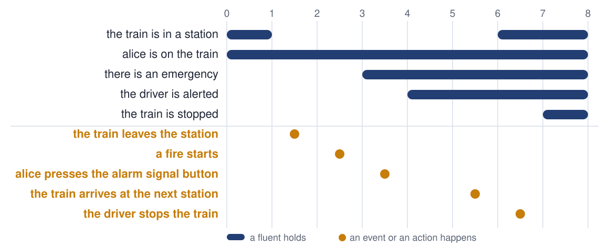
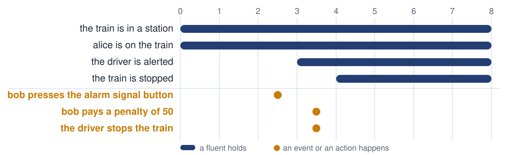

<!-- _class: title -->
<!-- _paginate: false -->
<!-- _footer: '' -->

# Two kinds of rules, in plain English

## Rule languages · Logical English · Logic Production Systems

Robert Kowalski · Imperial College London
JURIX 2026 tutorial · Toulouse · 8 December 2026

<!--
30 minutes, three parts. The clock, from the start of this slide:
- 0:00 The notice, and two kinds of rules (8 minutes).
- 0:08 Controlled natural language and Logical English (12 minutes).
- 0:20 Logic Production Systems (8 minutes).
- 0:28 What to take away, and hand over to Miguel.
One example carries the whole talk: the Emergency Notice of the London Underground.
-->

---

# A notice on the London Underground

> **Emergencies**
>
> Press the alarm signal button to alert the driver.
>
> The driver will stop if any part of the train is in a station.
>
> If not, the train will continue to the next station, where help can more easily be given.
>
> There is a 50 pound penalty for improper use.

Millions of passengers have read it. It is a program, written to be executed by people.

<!--
The notice is the first example of my book, Computational Logic and Human Thinking.
It is not a legal text. But it has everything that a legal text has: conditions, an exception, an instruction, a penalty, and words that it does not define.
Four sentences. We shall read each of them as logic.
-->

---

<!-- _class: divider -->

# 1 · Rule languages

Two kinds of rules

<!--
Time: 0:01.
-->

---

# The notice has two kinds of sentence

<div class="cols">
<div>

### What is the case

> The driver will stop if any part of the train is in a station.

It describes the world.

It is true or it is false.

It is a **belief**.

</div>
<div>

### What to do

> Press the alarm signal button to alert the driver.

It does not describe the world.

It asks for the world to be changed.

It is a **goal**.

</div>
</div>

<!--
This is the one distinction of the first part. Every rule language makes it, or hides it.
The second sentence of the notice is a prediction about the driver. The first sentence is an instruction to the passenger.
-->

---

# Belief rules

<div class="big">

*conclusion* **if** *conditions*

</div>

```
the train stops in a station
    if the driver is alerted
    and a part of the train is in the station.
```

- A belief rule defines its conclusion in terms of its conditions
- A set of belief rules is a **logic program**
- The same rule is used **backwards**, to answer a question, and **forwards**, to derive a consequence

<!--
Backwards: will the train stop? It will, if the driver is alerted and a part of the train is in a station. Two smaller questions.
Forwards: the driver is alerted, and the last carriage is in the station. So the train stops.
Prolog reasons backwards. Datalog reasons forwards. The rule is the same.
-->

---

# Goal rules

<div class="big">

**if** *conditions* **then** *conclusion*

</div>

```
if there is an emergency
then the driver is alerted.
```

```
it must not be true that
    the driver stops the train
    and it is not the case that the train is in a station.
```

- A goal rule does not define anything. It must be **made true**, by acting
- The first kind is a **reactive rule**. The second kind is a **constraint**
- An obligation is a goal. A prohibition is a constraint

<!--
A belief can be false. A goal cannot be false: it can only be violated.
Production rules, event-condition-action rules and the obligations of deontic logic are all goal rules.
The constraint is the "If not" of the notice: the driver does not stop between stations.
-->

---

# Goals say what. Beliefs say how.

<div class="cols">
<div>

### The goal

```
if there is an emergency
then the driver is alerted.
```

### A belief

```
the driver is alerted
    if a passenger presses
       the alarm signal button.
```

</div>
<div>

### The reasoning

1. There is an emergency. *An observation.*
2. So the driver must be alerted. *Forwards, with the goal.*
3. The driver is alerted if I press the button. *Backwards, with the belief.*
4. I press the button. *An action.*

</div>
</div>

**"Press the alarm signal button to alert the driver"** is the belief, written backwards.

<!--
This is how a passenger executes the notice. A goal is triggered by what the passenger sees. A belief reduces the goal to something that the passenger can do.
The whole of the third part, LPS, is this cycle: observe, think, act.
Time check: 0:06.
-->

---

# Rule languages take sides

| Mostly belief rules | Mostly goal rules |
|---|---|
| Prolog, Datalog, answer set programming, s(CASP) | Production rules: Drools |
| Catala, OpenFisca, RuleSpec | Event-condition-action rules |
| Decision tables | Obligations and prohibitions: LegalRuleML, L4 |
| Blawx, Epilog, Oracle Intelligent Advisor | Smart contracts: Solidity, Daml |

A language with one kind of rule must imitate the other kind.

**Logical English** writes belief rules. **Logic Production Systems** adds goal rules, and time.

<!--
The table is a simplification, and each community will object to its own row. That is a good discussion to have at the end.
The point: when two languages differ, ask first which kind of rule each one has. Miguel's tour shows sixteen of them.
Time: 0:08.
-->

---

<!-- _class: divider -->

# 2 · Controlled natural language and Logical English

English that a computer can read as logic

<!--
Time: 0:08.
-->

---

# English is expressive. It is also ambiguous.

<div class="cols">
<div>

> The driver will stop if any part of the train is in a station.
>
> If not, the train will continue to the next station.
>
> There is a 50 pound penalty for improper use.

- Stop **what**? And **where**?
- If **not** what?
- Improper use **of what**?

</div>
<div>

### A controlled natural language

A part of English with one reading only.

### Logical English

- *conclusion* **if** *conditions*
- No pronouns: **a** train, then **the** train
- One word, one meaning
- Time, but no tense

It is another way to write a logic program.

</div>
</div>

<!--
A person resolves these ambiguities without noticing. "If not" could mean: if the driver does not stop. It means: if no part of the train is in a station.
Logical English gives up elegant variation. It keeps the meaning.
It can be read without training in mathematics, in computing or in logic.
-->

---

# Templates

```
the templates are:
    *a person* presses the alarm signal button of *a train*.
    the driver of *a train* is alerted.
    *a part* of *a train* is in *a station*.
    *a train* stops in *a station*.
    *a train* continues to the next station.
```

- A **template** is the pattern of a sentence
- The words between asterisks are **places**. Each place stands for one thing
- In logic, a template is a predicate, and a place is an argument

<!--
The templates are the vocabulary of the program. Everything else is written with them.
"stops in" has two places: it is a relation between a train and a station.
-->

---

# The notice, in Logical English

```
the driver of a train is alerted
    if a person presses the alarm signal button of the train.

a train stops in a station
    if the driver of the train is alerted
    and a part of the train is in the station.

a train continues to the next station
    if the driver of the train is alerted
    and it is not the case that
        a part of the train is in a station.
```

**a** train introduces a variable. **the** train refers back to it. Nothing else is needed.

<!--
Read it aloud. It is longer than the notice, and it says exactly one thing.
"it is not the case that" is negation as failure: no part of the train can be shown to be in a station.
The first two words of each rule, "a train", mean "every train".
-->

---

# A scenario is a case. A query is a question.

```
scenario between stations is:
    alice presses the alarm signal button of the 8:15.
    stops expects answers [].
    continues expects answers ["the 8:15 continues to the next station"].

query stops is:
    which train stops in which station.

query continues is:
    which train continues to the next station.
```

- A **scenario** gives the facts of one case
- A scenario can say which answers it **expects**. Then the scenario is also a test

<!--
The facts are sentences of the same templates.
The tests stay with the program. When somebody changes a rule, the scenarios say what the change broke. The hands-on exercise does exactly that.
Time check: 0:14.
-->

---

# Every answer has an explanation

<div class="cols">
<div>

### Why?

```
the 8:15 continues to the next station
  the driver of the 8:15 is alerted
    alice presses the alarm signal
        button of the 8:15
  it is not the case that
    a part of the 8:15 is in a station
```

</div>
<div>

### Why not?

```
not: a train stops in a station
  the driver of the 8:15 is alerted
    alice presses the alarm signal
        button of the 8:15
  not: a part of the 8:15
        is in a station
```

</div>
</div>

The explanation is the proof. It uses the sentences of the program, so the reader of the rules can read it.

<!--
Both explanations come from the system as shown, for the scenario "between stations".
Why not is as important as why. In law, the party who loses wants the reason.
-->

---

# The fourth sentence: a citation, and a conditional answer

<div class="code18">

```
the templates are:
    *a person* is liable to a penalty of *an amount*.
    *a person* uses the alarm signal button improperly; unknown.

rule sentence_4 with provenance the Emergency Notice,
        confer "There is a 50 pound penalty for improper use":
a person is liable to a penalty of 50
    if the person presses the alarm signal button of a train
    and the person uses the alarm signal button improperly.
```

</div>

**Answer:** alice is liable to a penalty of 50, **assuming** alice uses the alarm signal button improperly.

The notice does not say what is improper. The program does not pretend to know.

<!--
The label of the rule cites its source, and quotes it. An explanation shows the citation.
"unknown" marks a template whose sentences may be assumed. In logic it is an abducible predicate, and the reasoning is abductive logic programming.
Law is full of such terms: reasonable, improper, without undue delay. The answer says which of them it depends on.
Time: 0:20.
-->

---

<!-- _class: divider -->

# 3 · Logic Production Systems

Rules in a world that changes

<!--
Time: 0:20.
-->

---

# The notice is about change

<div class="cols">
<div>

<div class="code18">

```
the events are:
    a fire starts.
    the train leaves the station.
    the train arrives at the next station.

the actions are:
    *a person* presses the alarm signal button.
    the driver stops the train.
    *a person* pays a penalty of *an amount*.

the fluents are:
    there is an emergency.
    *a person* is on the train.
    the driver is alerted.
    the train is in a station.
    the train is stopped.
```

</div>

</div>
<div>

- A **fluent** is a fact that changes over time
- An **event** happens, and changes the fluents
- An **action** is an event that an agent chooses

The same language. One new first line:

`the target language is: lps.`

</div>
</div>

<!--
The Logical English of part 2 described one state of the world. The notice describes a short history.
LPS: Logic Production Systems, with Fariba Sadri. It combines logic programs with production rules, and gives them one logical meaning.
-->

---

# Causal laws: what an event does

```
when a fire starts
then there is an emergency.

when a person presses the alarm signal button
then the driver is alerted.

when the train leaves the station
then it is not the case that the train is in a station.

when the train arrives at the next station
then the train is in a station.
```

- A **causal law** says which fluents an event starts, and which fluents it ends
- Causal laws are beliefs. A fluent that no event changes stays as it is

<!--
"A fluent that no event changes stays as it is" is the frame axiom. In LPS nobody writes it, and nobody computes it: the state is simply updated.
-->

---

# Goals: two reactive rules and a constraint

<div class="code18">

```
if there is an emergency
    and a person is on the train
    and it is not the case that the driver is alerted
then the person presses the alarm signal button.

if the driver is alerted at a first time
    and it is not the case that the train is stopped at the first time
then the driver stops the train from a second time to a third time.

it must not be true that
    the driver stops the train
    and it is not the case that the train is in a station.
```

</div>

The driver must stop the train **at some later time**. The constraint says **when the driver may**.

<!--
The first rule is the passenger. The second rule and the constraint are the driver.
Times are written only where a rule relates two moments. The driver's goal has no deadline; the constraint delays the action until the train is in a station.
Together, the second rule and the constraint are sentences two and three of the notice.
-->

---

# A fire between two stations



The events come from outside. The rules choose the actions. The timeline is the model that makes the goals true.

<!--
Read it from left to right. The train leaves the station. A fire starts. Alice presses the button, because of the first rule. The driver is alerted, because of a causal law. The driver cannot stop yet. The train arrives at the next station. The driver stops the train.
Nobody programmed "continue to the next station". It follows from a goal and a constraint.
Time check: 0:26.
-->

---

# The penalty is a goal too

<div class="code18">

```
if it is not the case that there is an emergency
    and a person presses the alarm signal button
then the person pays a penalty of 50.
```

</div>



An obligation is a reactive rule: when its conditions happen, an action must follow.

<!--
A second scenario of the same program: bob presses the button, and there is no emergency.
The driver stops the train all the same: the driver cannot know. And bob pays.
In part 2 the penalty was a belief: who is liable. Here it is a goal: what must happen. A legal text often needs both readings.
-->

---

# What to take away

<div class="big">

- **Belief rules** say what is the case: *conclusion* if *conditions*
- **Goal rules** say what must be made true: if *conditions* then *conclusion*
- **Logical English** writes rules in English that has one reading only
- **Logic Production Systems** makes the goals true in a world that changes

</div>

Next: sixteen other rule languages, read in the same English.

<!--
Time: 0:28. Hand over to Miguel for the tour.
If there is one sentence to remember: when you meet a rule, ask whether it is a belief or a goal.
-->
